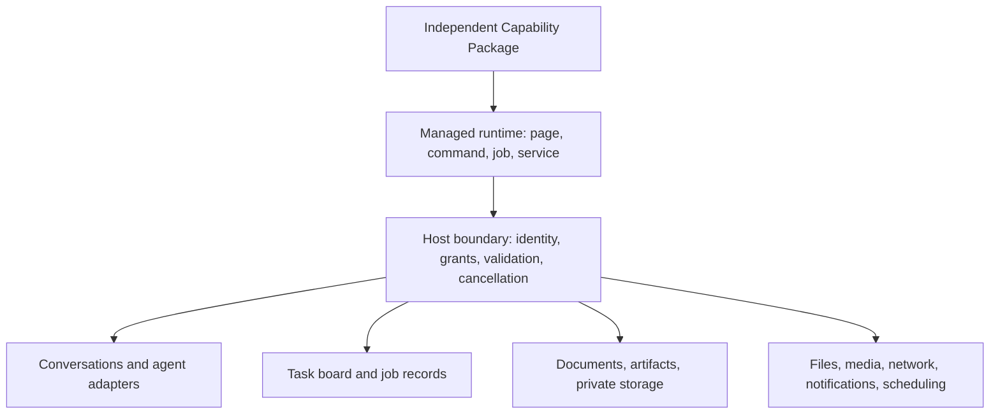

# Capability platform: the Nooki toolbox

- Date: 2026-11-19
- Status: product direction approved; interface and implementation proposal for review
- Baseline: Nooki 0.3.2, commit `6bb5e1c`
- Decision record: [ADR 0006](adr/0006-capabilities-as-the-product-core.md)
- Scope of this change: documentation only; no runtime, package format, SDK, or permission changes

## 1. Product intent and completion criteria

Nooki is a personal toolbox. Capability Packages are the independently made tools people put into
it: presentations, music, meeting notes, weekly reports, games, and uses the Nooki team has not
anticipated. Capabilities are the product's primary extension mechanism. AI is an optional shared
service, not a requirement for a capability to belong in Nooki.

Anyone should be able to use the developer Skill with a supported coding tool, build a package in
an independent directory, and install it without changing or rebuilding Nooki. The same package
should work for another user whose host meets its declared requirements. User accounts, grants,
credentials, local paths, and development-machine state must not be bundled into it.

The host provides shared services; a capability owns its domain behavior. Removing a capability
must remove its participation in the workspace without breaking the host, unrelated capabilities,
or the user's retained work. Using host services means using documented interfaces with appropriate
authorization, not unrestricted access to Nooki internals.

The decisive acceptance test is an independently developed, previously unanticipated capability
that can be installed, used, updated, disabled, and uninstalled using only the public contract.
The developer must not need a Nooki source checkout, a hard-coded exception in the shell, or access
to another capability's private data.

### Goals

1. Make business functionality independently distributable and removable.
2. Make chat, agents, the task board, execution records, and the Library usable through stable Host APIs.
3. Support interactive pages, explicit commands, finite jobs, and persistent in-app services.
4. Give the host enforceable control over authorization, execution, and resource cleanup.
5. Preserve user-owned artifacts and references across package removal and replacement.
6. Make the developer Skill and compatibility checks an executable expression of the contract.

### Non-goals for this plan

- Rewriting every existing Nooki feature as a removable capability.
- Building a marketplace, payments, ratings, cloud accounts, or cross-device synchronization.
- Implementing a new agent loop or replacing installed agents' model and authentication systems.
- Allowing arbitrary native executables, shell access, or unrestricted filesystem access in packages.
- Guaranteeing that every imaginable OS integration already exists. New shared primitives can be
  added to the Host when demonstrated needs justify them; business-specific code stays in packages.
- Running capability JavaScript after Nooki exits. This requires a separately designed execution
  service and is not implied by persistent in-app services or scheduling.

## 2. Current implementation and gaps

This table describes the inspected baseline, not the proposed end state. Existing tests establish
specific behaviors; they do not establish untrusted-code isolation or broad desktop compatibility.

| Area | Implemented baseline | Remaining gap |
|---|---|---|
| Installation | External ZIP import, version checks, enablement, update, previous-version rollback | Format and API compatibility need explicit evolution rules |
| Entry points | Required React Page, optional jobs and explicit conversation commands | Headless commands, persistent services, and implemented widget support are absent |
| Host services | Namespaced storage, single-answer AI, selected documents, publication, activity writes, environment | No public conversation handoff, task-board, or rich agent-run interface |
| Execution | Persisted task records, checkpoints, cancellation, retry, version fencing | Capability jobs have no public recovery hook; same-realm code cannot be forcibly preempted |
| Chat integration | Agents discover and invoke explicit commands through a shared broker | The reverse direction, capability-to-conversation interaction, has no public Host API |
| Documents | Markdown publication, authorized snapshots, durable references | General binary artifacts and package-initiated host selection are missing |
| Removal | Executables and registry entry removed; data and published documents retained | No complete resource teardown boundary or package-specific data-cleanup workflow |
| Runtime | Trusted package code executes in the shell's JavaScript realm | DOM, global state, styles, and resource faults are not isolated |
| Assets | ZIP contains manifest, one JS bundle, and optional CSS; assets are inlined | No general asset directory, binary resource contract, or large-artifact streaming |
| Developer experience | Portable Skill, scaffold, types, UI, checks, ZIP builder, skill-pool integration | Preview largely lacks executable Host services; desktop acceptance remains separate |

Source anchors:

- [Public types](../packages/capability-contract/src/index.ts) and [current contract](../packages/capability-contract/README.md).
- [Frontend lifecycle](../src/platform/capability-runtime.ts), [loader](../src/platform/package-loader.ts),
  [native lifecycle](../src-tauri/src/capability_runtime.rs), and [archive validation](../src-tauri/src/package_installer.rs).
- [Command broker](../src/platform/capability-broker.ts), [job adapter](../src/platform/tasks.ts),
  [task runner](../src/platform/task-runner.ts), and [separate task board](../src/features/task-board/task-board.ts).
- [Developer Skill](../skills/workbench-capability-dev/SKILL.md), [kit build](../scripts/build-capability-kit.mjs),
  and [preview Host](../skills/workbench-capability-dev/assets/starter/preview/main.tsx).

Contract drift must be resolved when the SDK is implemented: `widget` exists in the public entrypoint
union but is rejected by the developer checker; `activity.read` has no public reading method; the
infrastructure document still describes commands as reserved although the broker supports them.
The proposed APIs below must not be added to the released developer kit as if already available.

## 3. Ownership and dependency boundaries

| Concern | Nooki owns | Capability owns | Boundary |
|---|---|---|---|
| Product interface | Navigation, shared surfaces, installation and permissions UI | Its pages, translations, domain interactions | Registered entries and public UI/environment APIs |
| Business behavior | No domain-specific report, slide, playlist, or game rules | Algorithms, templates, rules, content, domain validation | Package code and package data |
| Chat | Conversation identity, navigation, captured context, user interaction | Which context or result to offer to a conversation | Explicit handoff and authorized conversation handles |
| Agents | Provider adapters, run routing, progress, approvals, cancellation | Task instructions and domain interpretation of results | Host-owned agent runs; no vendor protocol imports |
| Task board | User intent, assignment, acceptance, and durable item state | Proposals and authorized updates related to its work | Board API; never direct board-store mutation |
| Execution | Invocation authority, execution parentage, job state, cancellation, and explicit handoff to user-owned work | Immediate command handlers, finite jobs, and idempotent business steps | Command broker, Jobs API, and host-issued execution context |
| Data | Durable artifacts, stable references, access grants, export | Private settings, drafts, cache, and schema migrations | Artifact/document APIs and private storage |
| System access | File selection, allowed network/media access, notifications, scheduling | When its domain needs those services | Narrow, scoped service operations |
| Lifecycle | Installation state, compatibility, activation, resource termination | Optional preparation and cleanup within a bounded execution | Host remains able to stop a broken package |

Packages may depend on the SDK, package-owned libraries, and bundled assets. They may not import
Nooki feature modules, shell stores, internal Tauri commands, another package's storage, or agent
credentials. Nooki must not dispatch business behavior by hard-coded package ID. Existing legacy
exceptions can be retired separately without deleting historical data.

Built-in business capabilities should eventually use the same public contract and acceptance suite
as external ones. A capability installed from the source catalog must not acquire undocumented
privileges merely because it ships with Nooki.

The initial composition mechanism is a stable artifact reference or a conversation handoff.
Packages must not load one another's modules. Direct capability-to-capability invocation is deferred;
if later needed, it must use explicit public commands and the same authorization and result rules
as conversation invocation, without creating a private dependency on another package's jobs.

Provenance records which package produced an item; it does not determine who controls its lifetime.
Documents and board items become host-held user records when saved. Executions remain dependent on
their initiating package unless the host explicitly starts independent user-owned work as described
in section 7. Merely creating an item, attaching a result, or opening a conversation does not transfer
execution authority or imply that the user accepted a delivery.

## 4. Target architecture

The SDK is a typed client of the Host boundary, not an object containing unrestricted shell
functions. Runtime identity is issued by the host and bound to the actual caller. A request body
cannot choose the identity under which it is authorized. Authoritative operations validate the
installed version, activation generation, grants, and execution state before applying effects.

UI and execution lifetimes are independent. Leaving a page disposes its view but does not implicitly
cancel a submitted job or an explicitly started media service. Disabling the package stops its
dependent executions and services, but not work explicitly handed over to independent host ownership.
A service is not a hidden infinite job; it has its own visible running state and stop control.

Isolation is a required outcome for the new runtime, not a claim about today's loader. A technical
spike must choose an enforceable arrangement of separate web content, workers, or processes based on
desktop experiments. An iframe alone is not proof of origin, IPC, network, or resource isolation.
The proof must cover native bridge denial, caller authentication, storage separation, style/DOM
containment, blocking JavaScript, and forced termination. Reuse supported platform mechanisms rather
than inventing a general-purpose sandbox. See the phase 2 gate and unresolved decisions below.

## 5. Package and entrypoint contract

### Identity and compatibility

The next package format should explicitly distinguish package version, archive format version,
Host API compatibility, and private-data schema version. They solve different problems. A package
also declares required services and optional services; an unavailable required service blocks
activation with an actionable explanation, while optional services allow a documented fallback.

Manifest additions must describe entry IDs, asset locations, requested permissions and scopes, and
compatibility requirements. Command descriptions and schemas should be inspectable as static data
without executing package code. This improves inspection and catalog discovery and prevents
import-time code from becoming the permission review mechanism.

The implementation must settle exact field names and version-range syntax in the canonical schema
before publishing a new SDK. This document specifies the behavior, not a currently valid manifest.
Keep an immutable installed payload and a digest for integrity/conflict checks. A digest is not proof
of publisher authenticity. Trusted publisher verification and public catalog distribution are later
work; until then, installation must accurately explain the package's source and trust model.

Apply the approved-source continuity check to updates as well as reinstalls, before replacement
code or migration code receives existing private data. A matching package ID, higher version, or
unchanged permission list does not establish continuity. Record the reviewed source and the exact
accepted payload. If continuity is changed or unverifiable, show an explicit replacement decision
covering access to retained data and requested grants; do not silently inherit the old authority.
Declining leaves the old installation and data unchanged. Manual source approval must be labeled as
such, not presented as cryptographic verification. Publisher signing infrastructure is still deferred.

### Entry points

| Kind | Contract | Lifetime and visibility |
|---|---|---|
| Page | Optional interactive UI, own layout and state, host language/theme | Mounted while visible; may submit work with a separate lifetime |
| Command | Named public operation with input/output schemas, effect, and confirmation policy | Returns an immediate result or a reference to explicitly started long work; a Job is optional |
| Job | Private finite execution with cancellation, progress, and checkpoints | Continues across navigation; durable status and explicit retry |
| Service | Explicitly started long-lived in-app activity, such as playback | User-visible running state; host can stop it independently of any page |

A page-only game and a command-only summarizer must both be valid. Do not create placeholder pages
for headless packages. Widget and additional surface contributions remain deferred until a concrete
consumer establishes their rendering and lifecycle contract.

A command such as pause playback or open an editor should not manufacture a background Job.
The command broker still validates inputs/results, enforces authority, and records the necessary
invocation outcome. Use a Job when the operation needs background progress, cancellation, checkpoints,
or retry. Immediate handlers are bounded and cancellable; work that exceeds their execution budget
must use an explicit long-work contract rather than being silently replayed or converted to a Job.
Command result schemas distinguish an immediate value from an execution reference. An immediate
result may contain a separately authorized service handle; completing the command does not stop
that service or transfer it out of package ownership. Existing job-backed commands remain supported.

Package assets should be immutable, addressed relative to the package, and served with validated
types and paths. Support binary assets without embedding them in JavaScript. Preserve traversal,
symlink, duplicate-entry, archive expansion, and size checks; establish resource budgets with the
PPT and game acceptance packages. Do not bundle native executables or executable install scripts.
Generated artifacts and user data never live in the immutable package directory.
Publication must also remove dependencies on that directory: required passive assets must be embedded
or copied into host-held durable storage before the output can be considered independently retained.
The complete retention rule appears in section 6.4.

## 6. Host service interfaces

The operation names in this section are proposed API names, not shipped SDK calls. Before each
service ships, publish its exact TypeScript and wire schemas, errors, required grants, and tests
together. Do not expose an unbounded generic `invoke(method, any)` API to package authors.
The catalog is a target service map, not an instruction to ship every listed method in phase 1.
Implement only operations exercised by the current phase's acceptance package, with the matching
SDK, Skill guidance, and verification fixtures in the same slice.

### 6.1 Common request and resource rules

- Use opaque resource references, not filesystem paths. A reference identifies a resource; it does
  not itself authorize reading it. Host-issued grants bind caller, scope, and permitted operations.
- Bound list results with cursors and limits. Distinguish permission denial from missing resources
  without exposing metadata outside the caller's authorized scope.
- Mutating create/publish/start operations accept an idempotency key scoped to the package and
  operation. Persist a canonical payload hash and durable result or pending/unknown status. Same
  key and same input returns the same result; changed input is a conflict. Do not blindly rerun an
  externally applied effect after a transport timeout.
- Updates accept an expected revision and report conflicts rather than overwriting concurrent user
  edits. A retry must not silently replace newer work.
- Long work returns a run reference with snapshot, subscription, cancellation, and durable outcome.
  Subscription loss is not execution failure; reconnect by run reference before starting new work.
- RPC events and results are bounded, serializable data. Binary artifacts use host-managed transfer
  handles. Functions, credentials, live DOM nodes, and vendor session objects do not cross the boundary.
- Errors have stable codes and a user-safe message, with operation-specific structured details.
  Common codes include `INVALID_INPUT`, `PERMISSION_DENIED`, `RESOURCE_UNAVAILABLE`, `CONFLICT`,
  `UNSUPPORTED_SERVICE`, `INCOMPATIBLE_VERSION`, `CANCELLED`, and `OUTCOME_UNKNOWN`.
- Permission revocation, disablement, and runtime replacement invalidate active caller handles.
  Check authorization again at the effect boundary so a late result cannot publish after revocation.

### 6.2 Service catalog

| Service | Proposed public operations | Scope and result |
|---|---|---|
| `environment` | `getSnapshot`, `subscribe` | Locale, language, theme, and supported Host services; no shell store access |
| `navigation` | `openCapability` | Open a declared page with validated parameters and recipient-authorized resource context; never invoke a business command implicitly |
| `conversations` | `create`, `open`, `handoff`, `continue`, `observe` | Scoped conversation references; handoff opens a draft with explicit selected context; sending a turn is a separate authorized action |
| `agents` | `listAvailable`, `start`, `get`, `subscribe`, `cancel` | Host-owned agent run; capability-supplied instructions, authorized inputs, requested result schema, progress and artifact references |
| `board` | `requestSelection`, `create`, `list`, `get`, `update`, `attachDelivery`, `requestDelegation` | Host-selected or package-created items and scoped grants; creation does not imply delegation or acceptance |
| `jobs` | `start`, `get`, `list`, `subscribe`, `cancel`, `retry` | Package-owned finite execution; retain existing checkpoint semantics |
| `services` | `start`, `get`, `list`, `subscribe`, `stop` | Package-declared persistent in-app activity with a host-owned handle and visible stop control |
| `library` | `requestSelection` | Shared Library picker returns typed document snapshots or committed file artifacts with scoped read grants |
| `documents` | `readSelected`, `publish`, `open` | Authorized document snapshots and stable document references |
| `artifacts` | `create`, `write`, `commit`, `read`, `open`, `export` | Validated file metadata and transfer handles; only committed artifacts are durable user output |
| `storage` | `get`, `set`, `remove` | Package-private structured data; optional revision checks for concurrent writes |
| `activity` | `write`, scoped `list` | User-visible facts with provenance; read scope requires separate authorization |

Keep existing `ai.invoke` and `tasks` behavior as compatibility adapters. New packages should use the
explicit agent/job distinction once the corresponding APIs ship. Model calls, agent runs, execution
jobs, and task-board items are related resources, not interchangeable names for the same object.

### 6.3 Core inputs, results, and authorization

The following defines minimum semantic payloads; schema spelling and SDK ergonomics are finalized
in phase 1A. Every resource reference below is opaque and every grant is issued by the host. A
package cannot manufacture authority by sending fields such as `approved: true` or `capabilityId`.

| Operation | Caller supplies | Host returns | Authority required |
|---|---|---|---|
| `navigation.openCapability` | Declared page target, schema-valid parameters, optional resource references | Opened, dismissed, or unavailable result with a host fallback | Opening own page or a host-mediated user-selected target; recipient gets only explicitly authorized resource access |
| `library.requestSelection` | Purpose, supported kinds (`document` / `artifact`), media-type filters, selection limit | Typed snapshot/artifact references and scoped read grants, or explicit dismissal | Permission to request a picker; the user's selection authorizes this recipient and purpose |
| `documents.readSelected` | Snapshot reference and grant handle | Authorized content, title, revision and citation reference | Read grant for that exact captured selection |
| `artifacts.read` | Committed artifact revision reference and read grant | Metadata and bounded binary read handle | Read grant for that exact selected artifact revision |
| `documents.publish` | Stable key, title, collection metadata, content, source references, idempotency key, expected revision when updating | Durable document reference and revision | Publication authority and authorized source references |
| `conversations.create` | Title and idempotency key | Conversation reference | Authorized creation; no turn is sent |
| `conversations.handoff` | Optional authorized target, draft text, selected references, idempotency key | Target reference and draft/handoff receipt | Context-sharing grant; opening a draft is distinct from sending |
| `conversations.continue` | Target, message, input references and idempotency key | Turn/run reference | Authorization to send this turn with this input scope |
| `agents.start` | Task instructions, authorized sources, available agent selection, optional result schema, idempotency key | Run reference; later progress, questions, result and artifact references | Agent execution authority with an enforceable tool/effect policy |
| `board.requestSelection` | Purpose, selection limit, requested operations such as read or attach delivery | Selected item references, revisions and operation-scoped grants, or dismissal | Host selection and authorization UI; no full-board access or delegation implied |
| `board.create` | Title, description, source references and idempotency key | Item reference and revision | Board-write scope; no delegation implied |
| `board.update` / `attachDelivery` | Item reference, expected revision, permitted patch or delivery references, idempotency key | Updated item reference and revision | Write grant for the item; acceptance and delegation are not writable patch fields |
| `board.requestDelegation` | Item reference and proposed execution scope | Host decision receipt and, if authorized, execution reference | User or existing explicit delegation authority; package cannot approve itself |
| `jobs.start` | Declared job ID, schema-valid input and idempotency key | Execution reference and initial state | Package ownership plus invocation-specific authority |
| `services.start` | Declared service ID, validated input and idempotency key | Service reference, state and host-visible controls | Explicit authorization for continuing in-app activity |
| `artifacts.create` / `write` / `commit` | Metadata and stable key; bounded content chunks; completion request with idempotency key | Temporary transfer handle, then committed artifact reference | Artifact-write scope; commit validates complete content before publication |
| `artifacts.export` | Authorized artifact reference | Export receipt or dismissal | Read/export authority and host-controlled destination selection |

Snapshots of runs and services include identity, state, update revision, progress where applicable,
and terminal result/error references. Subscriptions identify event order and support resuming from
the last seen cursor; if history is unavailable, fetch a fresh snapshot. Only host-owned interaction
surfaces may resolve agent approval requests. Packages may display awaiting-input status and open
the relevant host surface, but cannot synthesize a user's answer or approval.

A service started by a command receives a separate host-owned lifetime and explicit service grant;
it must not extend the authority of a finished job implicitly. Repeating an identical start returns
the existing service handle. Starting another instance requires a distinct intent and the service's
declared concurrency policy. Finite jobs likewise declare or inherit a bounded concurrency policy;
the existing one-running-execution-per-job behavior remains the legacy default.
The host derives execution parentage from the initiating invocation, not a caller-provided owner
field. A nested agent run normally follows its parent Job's cancellation. Independent service
lifetimes and user-owned host work are explicit exceptions, governed by section 7.

### 6.4 Interaction semantics

**Navigation and return to work.** Pages declare stable entry IDs, parameter schemas, and accepted
resource kinds. A result can carry a reopen target for a host-rendered action such as “Edit this
presentation”; it contains entry identity and resource references, never a grant token, filesystem
path, or arbitrary executable URL. The host validates the target against the currently installed
version and obtains any recipient-specific grant before delivering the resource context. A link
does not silently install or enable a package, send a chat turn, or invoke a command.

Opening a target focuses the existing matching editor or opens the requested resource without
silently replacing another unsaved draft. The package persists its document/draft state; the host
preserves the return target and mediates a save/discard/cancel decision if leaving would lose work.
This does not require a new tab or window framework. If the package is missing, disabled, or no
longer supports the entry/resource kind, show a host-owned explanation and offer the retained artifact
preview/export or an explicit package-management action. Existing work remains intact. Package-to-
package navigation is only a user-mediated handoff through declared entries, not a callable private API.

**Conversations.** A package can offer a draft and selected references, then open the native chat
surface. It cannot silently send on the user's behalf, inspect unrelated history, or overwrite a
conversation's existing user draft. An active command receives only its explicitly permitted turn
context. Conversation creation can be idempotent, and continuing a specific conversation requires
an appropriate grant rather than possession of its ID alone.

**Agents.** Reuse host agent adapters and their approval/question surfaces. Return streamed progress,
structured results, and retained run identity without exposing vendor internals. A capability must
not invent its own credential store or approval dialog for an action owned by the agent. Run states
include queued, running, awaiting input, completed, failed, cancelled, and interrupted; an unknown
external outcome must remain visible rather than being labeled a retryable failure. Missing agents
disable AI-dependent operations with a clear explanation, not unrelated non-AI package functions.

**Task board.** A board item records what the user wants done. A job records one execution attempt.
An item may link to multiple jobs, conversations, and deliveries. A meeting package may create an
authorized draft item and attach a delivery, but it may not grant itself delegation authority or
mark its own output accepted. User review remains distinct from viewing a delivery. Initially expose
only package-created items and explicitly selected items; full-board access is not a default grant.
Use `board.requestSelection` to attach a delivery to an existing user task. The host shows the
recipient and requested operation; dismissal grants nothing. The returned revision protects against
concurrent edits. Selecting an item for attachment does not authorize changing its acceptance state,
delegating it, or reading other board items.

**Documents and artifacts.** The host owns selection and authorization UI. Opening that UI is not
permission to read the whole Library. Preserve immutable input snapshots and source citations.
The shared Library picker handles both documents and committed binary artifacts. A document selection
returns a captured snapshot; an artifact selection returns a retained revision and bounded read grant.
Package B can therefore use a user-selected output from package A without reading A's private storage,
including after A is uninstalled. Provenance is retained, and possession of A's reference does not
transfer A's authority. Writing changes requires separate publication/update authority; read selection
alone does not authorize overwriting the original.
Add typed file artifacts alongside Markdown rather than forcing binary data into document content.
Artifact creation must reserve an upload/transfer handle, validate size and type, then commit the
complete result atomically; failed partial transfers remain temporary and are cleaned up. An artifact
reference records identity, provenance, media type, and revision. It does not carry executable package
code. When a specialized viewer is unavailable, basic metadata, original-file export, and available
host previews must remain usable after uninstall.

Retaining output includes retaining its required package-owned dependencies. A published report's
images, or a presentation's required bundled assets, must be embedded or copied to host-held durable
storage and referenced from the committed result. Publication commits the output and these dependencies
together; failure leaves no apparently complete output. Retention and deletion must keep dependencies
while any retained output or revision needs them. Packages declare the dependency set and use the
publication pipeline to resolve it; raw package-local resource URLs are not valid durable references.
Do not attempt to infer every dependency by executing arbitrary HTML or package code.

If a dependency cannot be retained, reject independent publication with an actionable reason or offer
an explicitly labeled export/preview alternative. An interactive view that still needs executable
package code is not an independently usable artifact; keep an exportable representation and state
which editing/interactive behavior needs the package. External links may remain links, but external
content is not promised as offline retained output. Add no silent network copying or new data grants.

**Side effects.** Keep explicit command effect classification and platform-owned confirmation, but
do not trust classification alone as enforcement. A command labeled `read` must not obtain an
unapproved write through a lower-level API. Effective authority is the intersection of package
grants, invocation authorization, operation requirements, and current resource scope. The host
maintains this context across nested jobs and agent requests. Do not ask twice for the exact same
already-authorized effect; changed recipients, scopes, or effects need a new decision.

### 6.5 System services, added only with consumers

| Service | Initial intended scope | First consumer / delivery stage |
|---|---|---|
| File selection | Host picker returns scoped read/write handles, never unrestricted paths | PPT import/export, phase 2 |
| Media | User-initiated playback, observable session, pause/stop, resource cleanup | Music, phase 2 |
| Network connections | Declared destinations and operations with enforceable egress policy | Only when a real online package requires it; phase 2 spike or later |
| Notifications | Host-rendered notifications from an authorized package | Long job completion, phase 3 if needed |
| Scheduling | `create`, `list`, `pause`, `resume`, `remove` for an explicit user-created trigger referring to a package job | Weekly report, phase 3 |

The music acceptance package can use user-selected local files; an online music integration is not
a dependency of the runtime milestone. If authenticated third-party services are later required,
design host-managed connection handles before exposing them: do not put secrets in ZIPs, prompts,
logs, or package storage. This is separate from existing agent sign-in. No general shell or filesystem
API is introduced as a shortcut.

Scheduling initially executes only while the host is available. Store timezone and next trigger;
after downtime, surface a missed run or require an explicit catch-up policy. Do not duplicate a run
after restart, silently publish a report, or imply that quitting Nooki leaves a scheduler running.
Creation binds the declared job, version compatibility, schedule, timezone, input-source policy,
missed-run policy, and approved effects. A stable schedule-occurrence identity deduplicates runs.
Changing those terms requires reviewing the changed scope. Disablement suspends triggers; re-enabling
does not run missed occurrences implicitly. Uninstall removes active triggers while retaining history.

## 7. Lifecycle and resource ownership

Installation state and runtime state are separate. A valid installed package may be disabled or
temporarily blocked by an unavailable required service. Runtime failure must leave installation
management and rollback reachable.

| Transition | Host behavior | Data and work consequences |
|---|---|---|
| Inspect | Validate static metadata, contents, compatibility, budgets, and requested grants; execute no package code | No registration or business effects |
| Install | Review source/permissions, stage immutable payload, validate in an isolated context, atomically activate registry | Failed activation leaves the prior authoritative state intact; reinstall data access follows the approved-source check |
| Enable | Validate requirements, issue a fresh runtime identity, register available entries | No automatic AI calls, playback, or other business work |
| Open / close page | Create/dispose view and view-owned resources | Explicit jobs/services retain their independent lifetime |
| Start job / service | Record identity, authorization, owner/version and execution state before side effects | Show progress or running service and a stop control |
| Disable | Block package starts, revoke package handles, stop dependent work, remove entries and subscriptions | Retain data/history and independent user-owned host work |
| Update | Verify approved-source continuity or obtain a replacement decision before private-data access; review grants, stage version, quiesce old runtime, migrate, validate and switch | Preserve enabled state; rejection leaves old code/data intact; no silent reuse of old authority |
| Roll back | Stop current runtime, validate old code/data compatibility, activate eligible previous version | Preserve user artifacts; never imply arbitrary data or external effects were undone |
| Uninstall | Block package starts, revoke package authority, remove its schedules, stop dependent work/resources, unregister and remove code | Retain artifacts with their durable dependencies, history, private data by default, and independent user-owned host work |
| Delete private data | Show package-specific retained data and require a separate destructive decision | Remove only approved private data/cache; no implicit Library or task deletion |
| Quit / crash | End capability runtime; persist recoverable execution identity where possible | On restart, reconcile known external runs; otherwise mark interrupted, never blindly replay effects |

### Execution parentage and handoff

The host records provenance, execution parentage, and current lifetime ownership separately. A
package Job or command that starts an agent run creates a dependent child by default. Cancelling
the parent revokes authority for further effects across that dependent tree and requests cancellation
of its children. Record local cancellation separately from a still-running or unknown remote outcome;
do not show a cleanly stopped tree while a child still needs reconciliation. Retrying creates a new
attempt identity and must first reconcile earlier effects rather than duplicate them.

A service with an explicitly approved continuing lifetime is independent of the short command that
started it, but remains package-owned and stops on package disable/uninstall. Creating a board item,
publishing a document, or opening a chat draft saves a host record; none silently detaches a running
package execution. Merely viewing a result is also not an ownership transfer.

Independent host execution begins through a host-owned user action or an existing explicit user
delegation covering that work. For example, the user sends the handed-off chat draft or delegates a
selected board item. The host records the decision, captures durable inputs and required grants, and
starts a host-owned run that does not need package callbacks or private state. This run survives removal
of the originating package; its provenance still identifies that package. Grants are issued to the
new execution scope, not copied from the package's runtime token. A dependent execution that has not
completed must be stopped/reconciled before its work is restarted independently.

The initial contract does not migrate or reparent a live vendor run or package stack. If continuing
requires package code, offer keeping the package installed or handing off a durable result for new
host work; do not label it independent. The host serializes handoff and disable/uninstall decisions:
either the independent run's receipt and inputs are durably committed first, or handoff fails without
starting it. This prevents both lost user work and orphaned package execution.

### Cleanup ownership

Every page, job, service, subscription, timer, media handle, network request, and temporary transfer
has a host-tracked owner and lifetime. Package cleanup hooks are advisory and time-bounded. The
host must be able to terminate the containing runtime and release its resources if cleanup throws,
hangs, or is omitted. Remove CSS and UI contributions together with the corresponding runtime.

Cancellation is a request to stop work, not proof that an external effect was undone. The host
revokes future local effects immediately, records the outcome of remote cancellation, and presents
unknown external outcomes for reconciliation. A response arriving from an old runtime generation
must not mutate the new installation or resurrect a removed package.

Package identity alone is not enough to distinguish uninstall/reinstall. Use a fresh installation or
activation generation so old requests and grants cannot gain authority when the same ID returns.
Retained private data is available to a reinstalled package only after checking its schema and the
new installation's approved identity; a matching ID must not silently bypass source review.
The same check applies to updates before migration or replacement code can read that retained data,
as required by section 5. Source approval and data-schema compatibility are separate checks.

### Update and private-data migration

Stage migration against an isolated copy or transaction of package-private data. Migration has no
network, agent, board, or artifact side effects. Activate code and compatible private state together,
or keep the prior pair authoritative. Define recovery for crashes before and after activation.
Keep the previous compatible private-data snapshot for the supported rollback window and explain
any private edits that rollback would discard, requiring confirmation before discarding them.
If safe rollback is unavailable, block it with a
reason instead of pairing old code with incompatible data. Published user work is never rolled back
as part of a package update.

## 8. Runtime policy and limits

The new runtime must enforce the boundary below; static SDK checks remain useful diagnostics but
are not the authority. The legacy runtime remains explicitly trusted-only until migration.

- Package code cannot read shell storage, use the native bridge directly, or impersonate a caller.
- Package UI cannot alter the shell or another package's UI through DOM or CSS access.
- Unapproved outbound network traffic is blocked; routing a package through a broker is insufficient
  if it can still use an unrestricted browser network channel.
- Faults and unresponsive code are contained sufficiently that the user can disable the package.
- Permissions are scoped to resources and purposes, revocable, and checked at the authoritative
  operation boundary. Optional permissions may be requested when first used; denial has a defined UI.
- All resource types have bounded budgets, including archive expansion, transfers, private storage,
  concurrent runs, queued events, and live services. Establish measured limits during the runtime
  spike and expose actionable limit errors; do not invent unlimited defaults.
- Logs record package/version, run ID, operation, duration, and outcome. Input documents, prompts,
  credentials, and arbitrary private payloads do not belong in operational logs. Retained user-visible
  execution history follows a separate export and deletion policy.

Runtime isolation does not by itself make an authorized agent safe to run arbitrary tools. Agent
delegation is a separate authority boundary: reuse agent and host approval policies, constrain input
scope, and verify that the selected adapter can honor the requested execution policy. Do not claim
unsupported restrictions merely because they were written into a prompt.

## 9. Developer Skill and verification workflow

The developer kit is generated from one canonical Host schema/type source. Manifest validation,
runtime validation, preview fixtures, and examples must share it rather than maintaining divergent
permission and entrypoint lists. The Skill must describe only released APIs and identify its target
Host API and package-format compatibility.

The minimal SDK, developer Skill update, test Host fixtures, and a separate desktop test profile are
part of every phase from phase 1A onward. A profile may initially be a documented isolated-data launch
procedure; a polished development UI is not required. No phase passes using internal imports, a
hand-maintained private SDK, or temporary grants unavailable to ordinary packages. Each service slice
updates the distributable kit before its acceptance package is built outside the Nooki checkout.
Phase 3 improves tooling and broadens compatibility coverage; it does not introduce independent
development for the first time.

The supported workflow is:

1. Describe the capability and choose only the required entrypoints and Host services.
2. Scaffold an independent project using the integrated or exported developer Skill.
3. Build domain behavior against the public SDK; no Nooki checkout or private source import.
4. Run deterministic tests with a test Host: granted/denied/revoked permissions, missing agent,
   offline state, cancellation, malformed inputs, update conflicts, and failed persistence.
5. Preview relevant empty/loading/error/success states, both languages and themes, and narrow/wide layouts.
6. Pack and inspect the actual archive, including permissions, resources, and compatibility metadata.
7. Use a dedicated desktop development profile for real Host verification and package lifecycle tests.
8. Deliver source, archive, required services, requested permissions, and an honest verification report.

Keep preview, simulated Host execution, desktop Host execution, and real external service/agent
execution separately labeled. A passing preview is not proof that native services work. Reuse the
production boundary in desktop test mode; do not give development packages hidden privileges.
Development reload should replace only the selected package's runtime and preserve unrelated work.

The existing external-tool workflow remains supported. A future Nooki conversation may orchestrate
the same Skill and display the resulting package for installation review, but automatic silent
installation is not part of the contract. An entirely in-app authoring flow is not a prerequisite
for proving independent package creation.

## 10. Compatibility and migration

1. Preserve the existing external ZIP path and legacy Host APIs while the new runtime is developed.
   Label legacy packages as trusted-only; never relabel them isolated without converting and testing.
2. Separate the new archive/runtime format from the application version. Reject unsupported formats
   or required API versions before execution, with the supported upgrade path.
3. Add service adapters over existing conversation, board, agent, and Library owners. Do not duplicate
   their persistence or introduce a second execution engine merely to expose an API.
4. Keep `ai.invoke`, `tasks`, existing document references, and historical task records readable.
   Map old calls to new services where semantics are equivalent; preserve differences explicitly.
   Existing commands remain job-backed through the legacy adapter; immediate command results belong
   to the new contract and do not change legacy retry or checkpoint semantics.
5. Introduce optional pages and assets with new format validation; do not pretend existing v1 archives
   can accept files their installer currently rejects.
6. Version every grant and activation identity. Do not transfer newly requested permissions, wider
   scopes, or old runtime tokens across an update silently. Preserve or reissue unchanged grants only
   under a documented compatibility rule; keep historical citation snapshots readable by the user.
   Update and reinstall source continuity must be checked before granting replacement code access
   to retained private data. A changed or unverifiable source takes the explicit replacement path.
7. Migrate bundled business capabilities through the same SDK. Remove legacy package-specific shell
   branches only with data and reference regression tests.
8. Publish a migration guide and deprecation window before retiring v1. Removal requires an inventory
   of supported fixtures, migrated examples, user-visible diagnostics, and a documented recovery path.
   No retirement date is committed in this design.

API additions should be backward compatible within a supported major version. Breaking changes
require a new major contract and a migration path. Use one canonical implementation with adapters
where possible, not independently evolving forks of every Host service. Updating the SDK does not
authorize modifying a user's locally edited developer Skill; preserve the existing integration
conflict and recovery behavior.

## 11. Phased implementation plan

The executable task sequence, dependencies, delivery rules and evidence requirements live in the
[implementation plan](capability-platform-implementation-plan.md). Track progress only in its [task checklist](capability-platform-implementation-tasks.md).
The phase definitions below remain the design-level acceptance contract.

Each slice should be independently reviewable. Dependencies and exit gates determine progression;
no calendar estimate is asserted here. A later phase cannot waive an earlier failed gate. Reference
packages are validation fixtures and examples, not commitments to full commercial applications.
Every slice includes the corresponding public kit update and independent-package verification.
Use the target service catalog to avoid conflicting designs, but do not implement unused methods
as prerequisites. M7 is a recurring check in phases 1 and 2 and a broader compatibility gate in phase 3.

### Phase 1: public shared services and a complete meeting workflow

**Entry:** this design reviewed; current regression tests remain the baseline.

| Slice | Work | Verification / exit evidence |
|---|---|---|
| 1A: contract and minimal kit | Define only the meeting workflow's schemas, references, identity, grants, errors and idempotency; export SDK/Skill/fixtures and an isolated desktop test-profile procedure | An independent scaffold uses the exported kit; unsupported services and forged identities fail at the public boundary |
| 1B: workspace integration | Document selection/publication, chat draft handoff, board creation, existing-item selection and delivery attachment over current owners | Read only selected snapshots; attach to a pre-existing task with a scoped grant; no unsolicited send or self-delegation/acceptance |
| 1C: execution ownership | Add the agent start/observe/cancel operations needed by the meeting Job, cancellation parentage, and explicit host delegation receipts | Cancelling a Job cancels/reconciles its agent child; independently delegated host work survives package removal; reconnect does not duplicate runs |
| 1D: independent meeting package | Build with the same distributed SDK/Skill outside Nooki; publish notes, create or select a board item, hand context to native chat | M1 and the phase-1 subset of M7 pass on an isolated desktop profile without internal imports, private tools, or host package-ID branches |

**Exit gate:** the meeting workflow passes M1 and phase-1 independent-development checks from M7,
including refusal, retry, cancellation, and explicit handoff paths. New Host
operations enforce authorization in their authoritative owner. Until phase 2 passes, packages still
have the current trusted-code limitation; phase 1 does not authorize broad untrusted distribution.

**Preserve:** current ZIP installation, command discovery, old document citations, user board semantics,
checkpoint retry, and developer Skill integration behavior. Update current-contract documentation
and the distributed kit only for implemented services, not all proposed operations at once. Rich
conversation-history APIs, broad board listing, and other unused catalog methods are not required
to pass this phase.

### Phase 2: diverse package forms and enforceable lifecycle

**Dependency:** phase 1 identity and service semantics. The isolation spike can begin earlier, but
new runtime integration must use the same authority model.

| Slice | Work | Verification / exit evidence |
|---|---|---|
| 2A: runtime spike | Compare viable desktop isolation arrangements; decide IPC, native access, media, network, termination, and budgets | Record a runtime ADR with reproducible containment probes; no selection based only on a browser mock |
| 2B: package format and execution | Optional pages, declared reopen targets, immediate/long-work command results, assets, finite jobs, visible services | Headless and immediate commands need no fake page/Job; reopening preserves other drafts; service survives navigation; failed runtime is stoppable |
| 2C: artifacts and files | Transfer/commit/export, retained dependency sets, typed Library selection and grants, local file selection | Actual PPTX opens independently; partial publication leaves no complete result; another package reads a selected retained artifact after producer uninstall |
| 2D: lifecycle transactions | Source continuity before data access, explicit replacement path, generation revocation, uninstall cleanup, private-data migration and rollback | Changed-source update cannot read data before approval; handoff/removal race has one outcome; activation failure preserves a recoverable code/data pair |
| 2E: representative packages and kit | Build local music, game, PPT and headless packages with the phase's exported SDK/Skill and fixtures | M2–M5, M8 and phase-2 M7 checks pass in desktop Nooki; package resources and APIs have no private host dependencies |

**Exit gate:** the user can stop/remove a faulty package while the shell and unrelated work remain
usable; all package-owned runtime resources are reclaimed; uninstall preserves artifacts and references.
The retained artifacts include required passive dependencies, and remain selectable by another
authorized package. Reopen actions have tested missing/disabled/incompatible-target fallbacks.
Document the actual isolation guarantees and remaining OS limitations. Do not claim arbitrary native
package support, unlimited resources, or execution after application exit.

### Phase 3: repeatable third-party development and compatibility

**Dependency:** phase 2 runtime and artifact contracts accepted and versioned.

| Slice | Work | Verification / exit evidence |
|---|---|---|
| 3A: developer kit hardening | Expand the SDK/Skill, validators, fixtures and examples delivered in earlier phases; enforce canonical-contract consistency | Multiple independent packages pass using the exported kit; it cannot advertise unsupported services |
| 3B: desktop development experience | Add convenient trial installation, package-specific reload, permissions preview and diagnostics to the existing isolated-profile workflow | Rejected/failed development installs do not affect ordinary user data or another installed package |
| 3C: conformance suite | Versioned package fixtures for positive/negative cases and legacy compatibility | Repeatable checks on each supported desktop platform and Host release |
| 3D: scheduled weekly report | Minimal user-authorized schedule and missed-run policy; notification only if required | M6 passes; disabled/uninstalled package cannot fire; no duplicate catch-up or silent publication |
| 3E: migration and release readiness | Migrate first-party examples, publish compatibility matrix and troubleshooting guide | Fresh-user install plus upgrade-from-v1 evidence; known limits stated; no obsolete kit instructions |

**Exit gate:** someone using only the distributed developer Skill can build, verify, share, install,
upgrade, and remove a capability without assistance from Nooki's internal code. Validate on a second
clean profile with different paths and without the author's settings or grants. Marketplace and
publisher infrastructure remain separate future requirements.

## 12. Acceptance matrix

All scenarios require actual packaged archives and real desktop Host behavior. Use deterministic
agent doubles for failure tests plus an explicitly recorded real-agent run for AI integrations.
If an external dependency is unavailable, record that scenario as unverified, not passed.

| ID / scenario | Required behavior | Negative and lifecycle checks |
|---|---|---|
| M1: meeting notes | Select text, run an agent, publish notes, create or select a pre-existing board item, attach a delivery, hand context to chat | Dismissed selection grants nothing; existing-item grant permits only requested operations; Job cancellation reaches its agent child; explicit host delegation survives package removal |
| M2: presentations and retained output | Generate/export a valid PPTX, reopen its editor from a chat result, then select it in a second package after removing the producer | Partial publication commits nothing; bundled passive assets remain available; read-only selection cannot overwrite output; missing/disabled/incompatible editor falls back to retained artifact access without losing another draft |
| M3: music | Select local audio, play/pause through immediate commands, navigate to chat while playback continues, observe the service | No AI dependency or Job for pause; the completed start command does not stop its authorized service; disable/uninstall does stop it; restart does not autoplay |
| M4: game | Install an independent interactive game with packaged assets and private saved state | No agent needed; DOM/CSS cannot alter shell; deliberate infinite-loop fixture is terminable; other capabilities remain usable |
| M5: headless command | Install without a Page; invoke one immediate operation and one operation returning a long-work reference | Immediate result creates no Job; long work stays observable/cancellable; schema mismatch and unauthorized writes fail; disabled commands disappear |
| M6: weekly report | User authorizes a schedule, sources and draft generation; a visible run produces a reviewable result | Missed-trigger behavior is explicit; restarting does not duplicate a run; permission revocation, disablement or uninstall prevents future triggers |
| M7: independent developer, every phase | Scaffold, check, pack and install each phase's reference package using only its exported SDK/Skill on a separate desktop profile | No source checkout, private tooling, author paths or implicit grants; unsupported requirements fail; phase 3 extends the same checks to a second clean profile and supported compatibility combinations |
| M8: compatibility and failure | Update/replace and roll back representative legacy/new packages with compatible private state | Same ID/version progression does not prove source continuity; unapproved replacement/migration cannot read old data; declined changes preserve old installation; crash recovery and stale-generation rejection hold |

Required focused checks within these scenarios:

- **M1:** distinguish a package-owned agent child from a newly user-delegated host run. Cancel the
  first while active, uninstall the originating package during the second, and verify both outcomes.
  Opening the chat draft alone must not create an independent run. Repeat a submission to confirm
  it creates no duplicate task; viewing a delivery must not accept it. Missing agents and declined
  approvals must fail without side effects; reconnecting to a known run must not start it again.
- **M2:** publish a report containing a bundled image, remove the package and its assets, and render
  the retained report. Inject a dependency-copy failure and verify atomic publication. Reopen deck A
  while deck B has unsaved edits; verify preserve/save/discard/cancel behavior and fallback after
  package removal. In package B, select the retained PPTX using the host picker and read its binary
  content without export/re-import; deny a write attempted with only that read grant. Open the exported
  PPTX in an independent reader, and verify that cancelling export never reports success.
- **M8:** submit a higher-version archive with the same ID and permissions but changed or unverifiable
  source. Confirm that no migration or replacement code receives old private data before the explicit
  replacement decision. Declining replacement or expanded permissions must leave the original
  installation usable. Race host handoff
  against uninstall and verify a durable independent receipt or no started run, never an orphan.

Cross-cutting evidence must additionally cover malformed archives, caller spoofing, direct native
bridge attempts, cross-package storage reads, unapproved egress, subscription/handle cleanup,
concurrent user edits, repeated effect requests, host restart, and artifact access after uninstall.
Resource tests must measure the selected budgets rather than merely assert that the UI has an error
boundary. Validate language/theme/layout where a package has UI, not as fake requirements for a
headless package.

For every acceptance run retain: host/API/format/package versions, test profile and platform,
grant decisions, archive identity, steps and observed outcomes, relevant run/artifact references,
and explicitly unverified items. Do not retain credentials or private source content in test reports.

## 13. Decisions, trade-offs, and unresolved implementation choices

### Settled direction

- Capability Packages are the core extension mechanism; non-AI use cases are first-class.
- Nooki owns shared services and user data; packages own domain behavior and private state.
- Page, command, job, and service are separate optional contributions with distinct lifetimes.
- Stable public interfaces and host-owned authorization are required; internal imports are forbidden.
- Published artifacts survive uninstall; destructive private-data cleanup is separate.
- Provenance does not imply execution ownership; independent host work requires an explicit handoff.
- Retained output includes required passive dependencies and can be selected by another authorized package.
- Commands may complete immediately; only work needing a separate execution lifetime creates a Job.
- Each implementation slice ships its usable public kit and independent verification path.
- Keep the existing foundation and migrate incrementally, rather than rebuild the whole application.

### Choices to resolve before their dependent slice ships

| Question | Decision gate | Required evidence |
|---|---|---|
| Exact service schemas, references, grants, and API negotiation | 1A, per-service review | Typed examples for meeting workflow, error/permission matrix, compatibility tests |
| Runtime isolation topology and transport | 2A, runtime ADR | Desktop containment, forced-stop, IPC identity, media, network, and resource-budget probes |
| Artifact storage/transfer mechanism and practical budgets | 2C | PPTX/audio fixtures, partial-transfer recovery, export and retained-reference checks |
| Migration transaction and rollback retention policy | 2D | Crash matrix, code/data atomicity, private-edit loss explanation, disk-budget evidence |
| Supported platform coverage for new runtime | 2A and 3C | List actual tested platforms; do not infer parity from one desktop environment |
| Schedule execution availability and catch-up UX | 3D | Timezone/restart/missed-trigger tests and user-visible policy |

These are implementation gates, not reasons to defer the already-defined ownership and product
boundaries. They must be resolved with narrow experiments before dependent APIs are promised.

### Alternatives not selected

- **Expose internal stores and native calls:** faster initially, but makes host refactors and package
  authorization inseparable from every package implementation.
- **Require every capability to be a chat skill:** excludes direct-manipulation tools, music and games,
  and confuses instructions for creating/using a package with the installed runtime itself.
- **Keep a mandatory page:** creates artificial UI for headless operations and does not solve service lifetime.
- **Require a Job for every command:** adds execution lifecycle overhead to immediate controls such as
  pause playback or open a page; validation, authorization and invocation receipts remain in the broker.
- **Build the whole service catalog before a consumer:** expands the first release without proving
  independent package development; deliver only the operations used by each phase's reference packages.
- **Trust static checks as isolation:** useful developer feedback, but cannot enforce runtime authority
  or stop a package that blocks the shell.
- **Replace all built-in features at once:** expands migration risk without being required to prove
  that new business capabilities can remain independent.
- **Build a marketplace first:** improves discovery before compatibility and containment are dependable.

## 14. Documentation and delivery responsibilities

[ADR 0006](adr/0006-capabilities-as-the-product-core.md) records the approved product direction and
the limited supersession of ADR 0005. This document is the implementation roadmap. The public types,
contract README, infrastructure notes, developer Skill, and acceptance fixtures must be updated with
each implemented slice so they remain descriptions of released behavior.

Each implementation PR must identify its slice and acceptance IDs, explain user-visible behavior,
state compatibility impact, and attach verification evidence and remaining limitations. Keep PRs
open for human review. Changes to this design do not themselves implement or release any API.
