# Capability platform implementation plan

- Date: 2026-11-19
- Planning baseline: design revision `c631006`; application baseline remains Nooki 0.3.2
- Status: implementation underway; current status is recorded in the task checklist
- Design authority: [Capability platform design](capability-platform-design.md) and [ADR 0006](adr/0006-capabilities-as-the-product-core.md)
- Task state and detailed acceptance: [implementation checklist](capability-platform-implementation-tasks.md), the single task-status record
- Current review: [PR #38](https://github.com/T-X-R/nooki/pull/38)

## 1. Scope and starting point

Implement the approved toolbox design incrementally. Preserve current packages and user data while
opening shared Host services, introducing independently stoppable package runtimes, and making the
developer Skill sufficient for independent development. This plan creates no implementation, API,
package format, release, or claim that future acceptance tests already pass.

There are 35 parent implementation tasks and 12 verification checkpoints; suffixed subtasks refine
those deliveries without changing the scope. Use the checklist for the next eligible task. Earlier
design review and the baseline's passing tests do not count as implementation completion.

The design specifies behavior; this document specifies sequencing and delivery. Keep product scope
unchanged. Exact schema spelling, isolation topology, and budgets are resolved by the designated
tasks with evidence. If an experiment cannot meet a design invariant, report the result and revise
the proposal explicitly; do not weaken acceptance or silently broaden permissions.

## 2. Execution order and phase gates

| Order | Tasks | Delivered outcome | Checkpoint |
|---|---|---|---|
| 1 | P00–P02 | Reproducible baseline, minimal portable kit/profile, early runtime feasibility decision | K0 |
| 2 | C01–C03 | Scoped invocation context, selected documents, idempotent board-item creation | K1 |
| 3 | C04–C06 | Existing-task attachment, chat draft handoff, observable agent work | K2 |
| 4 | C07–C09 | Cancellation ownership, independent host delegation, external meeting package | K3: phase 1 exit |
| 5 | R01–R03 | New package structure, authenticated bridge, isolated page execution | K4 |
| 6 | R04–R06 | Immediate commands, continuing services, approved-source update boundary | K5 |
| 7 | R07–R09 | Durable binary output, retained dependencies, cross-package selection | K6 |
| 8 | R10–R12 | Reopen navigation, transactional private-data migration, local music package | K7 |
| 9 | R13–R15 | Presentation, game and headless reference packages | K8: phase 2 exit |
| 10 | T01–T03 | Hardened public kit, development UX, repeatable compatibility coverage | K9 |
| 11 | T04–T06 | Authorized in-app scheduling and a weekly-report package | K10 |
| 12 | T07–T08 | Supported-example migration and final clean-profile/upgrade evidence | K11: phase 3 exit |

The table contains **12 checkpoints, K0–K11**; K0 is the preparation checkpoint, followed by 11
delivery checkpoints. Use the IDs, not an inferred percentage, when reporting progress.

Default to the table's sequential order. Explicit dependency lists in the checklist additionally
describe what each task consumes. Passing tests in one task does not waive a pending earlier
checkpoint. P02 brings design slice 2A's bounded feasibility experiment forward; production runtime
replacement still belongs to phase 2. It prevents phase 1's transport assumptions becoming an
accidental permanent contract.

```mermaid
flowchart LR
    P[P00-P02: baseline, kit, feasibility] --> C[C01-C09: meeting workflow]
    C --> G1[K3: phase 1 gate]
    G1 --> R1[R01-R06: runtime and commands]
    R1 --> R2[R07-R12: output and lifecycle]
    R2 --> R3[R13-R15: reference packages]
    R3 --> G2[K8: phase 2 gate]
    G2 --> T[T01-T08: development and compatibility]
    T --> G3[K11: phase 3 gate]
```

**Phase 1 / K3:** M1 and phase-1 M7 pass using an exported kit and an isolated desktop profile.
Package-owned child execution cancels correctly; separately authorized host work survives removal.
The legacy same-realm runtime remains explicitly trusted-only.

**Phase 2 / K8:** M2–M5, M8 and phase-2 M7 pass, with M1 rerun against the new runtime. Containment,
forced stop, passive dependency retention, cross-package file selection, and update/reinstall data
boundaries must be proven in desktop Nooki. No untrusted-package claim before this gate.

**Phase 3 / K11:** M1–M8 pass on the declared support matrix. Scheduling has explicit availability
and missed-run semantics. An independent user can use the exported kit, install packages on a clean
profile, upgrade, and remove them without host source or private author settings.

## 3. Existing owners to extend

These are code-navigation anchors, not permission to refactor whole subsystems. Each task lists a
small starting footprint; proposed new files are marked as such in the checklist.

| Concern | Existing owners and regression anchors |
|---|---|
| Public contract and kit | `packages/capability-contract/src/index.ts`, `scripts/build-capability-kit.mjs`, `skills/workbench-capability-dev/`, `tests/developer-kit.test.ts` |
| Package loading and lifecycle | `src/platform/capability-runtime.ts`, `src/platform/package-loader.ts`, `src-tauri/src/package_installer.rs`, `src-tauri/src/capability_runtime.rs` |
| Invocation and execution | `src/platform/capability-broker.ts`, `src/platform/tasks.ts`, `src/platform/task-runner.ts`, `src-tauri/src/task_execution.rs` |
| Board ownership | `src/features/task-board/task-board.ts`, `src/features/task-board/task-board-store.ts`, `src-tauri/src/task_goals.rs`, `src-tauri/src/task_worker.rs` |
| Chat and agents | `src/features/conversation/conversation-client.ts`, `src/features/conversation/conversation-jobs.ts`, `src-tauri/src/conversation_host.rs`, `src-tauri/src/agent_tools.rs` |
| Documents and grants | `src/platform/document-grants.ts`, `src/platform/document-library.ts`, `src-tauri/src/document_grants.rs`, `src-tauri/src/document_library.rs` |
| Navigation and installation UI | `src/app/App.tsx`, `src/features/capabilities/CapabilityPage.tsx`, `PackageImportModal.tsx`, `DeveloperCenterModal.tsx` in that feature directory |

In particular, the native Goals/worker path already owns current task-board execution. Do not expose
the legacy renderer-only dispatcher as the new authoritative board execution API. P00 must reconfirm
the owning paths before modification; repository state may change after this plan was written.

## 4. Per-task delivery contract

1. Read the design sections named by the task and verify dependencies against the current tree and
   the evidence receipts. Record the task as in progress with its branch/PR and concrete scope.
2. Deliver one usable path, including its UI when needed, authority checks, failure behavior, focused
   tests, and corresponding exported SDK/Skill update. Do not implement the rest of a service catalog.
3. Verify the actual archive on the isolated desktop profile where Host behavior matters. Simulated
   preview and mocked browser tests are separate evidence, not substitutes for native acceptance.
4. Apply the repository's delivery workflow: commit, push, keep the active PR open for human review,
   and rebuild/reinstall the local desktop app after each completed verified change. Quit normally
   first and use the existing installer; do not terminate unrelated agent work.
5. Save the task's evidence receipt and update its checklist status. An unchecked failure or unavailable
   external verification cannot be relabeled passed to clear the next gate.

S and M in the checklist mean small and medium target slices, not time promises. Target about 1–5
primary implementation/test files. Shared contract/kit/docs updates are mandatory, not a reason to
leave them behind. If inspection reveals a larger change, split it into suffixed tasks (for example
`R03a`, `R03b`) **before implementation**, with explicit dependencies and a separately verifiable
outcome for each. The parent is complete only when every child passes. Do not turn a task into an
unreviewable runtime rewrite or fake smallness by moving complexity into a new large file.

Task IDs do not automatically create new requirements, branches, or PRs. Reuse the existing branch,
worktree and open PR for this ongoing requirement, as project instructions require. After a human
merge, fetch current `origin/master` and follow the normal feature-branch workflow for the next
authorized delivery. Never merge automatically, push to `master`, or upload local `AGENTS.md`.

## 5. Verification commands and evidence

Run the focused suites for the changed behavior. Add meaningful tests for the new operation before
claiming its acceptance; the baseline commands below do not by themselves cover future services.

| Code | Baseline command / verification procedure |
|---|---|
| V-P | `node --test tests/package-loader.test.ts tests/capability-broker.test.ts tests/task-runner.test.ts` and `cargo test --offline --test package_installer_test --test capability_runtime_test` in `src-tauri` |
| V-K | `node --test tests/developer-kit.test.ts` and `cargo test --offline --test developer_integration_test` in `src-tauri`; export kit, scaffold outside checkout, check and pack there |
| V-D | `cargo test --offline --test document_grants_test --test document_library_test` in `src-tauri`, plus focused Library tests for changed behavior |
| V-B | `node --test tests/task-board.test.ts` and `cargo test --offline --test task_goals_test` in `src-tauri`; preserve native board semantics |
| V-A | `node --test tests/conversation.test.ts tests/capability-invocations.test.ts tests/conversation-capability-sources.test.ts` and affected native conversation/agent tests |
| V-UI | Relevant scripts in `tests/ui/`, with their configured local server and installed browser dependency; record mocked-host coverage as such |
| V-N | Actual packaged archive on the isolated desktop profile; retain steps, observed UI/state and artifact results, including restart/uninstall where specified |
| V-F | At phase gates: `npm test`, `npm run build`, `cargo test --offline` in `src-tauri`, relevant UI regressions, and the phase's V-N scenarios |
| V-APP | `npm run desktop:build`, normal quit, `npm run desktop:install`, and `codesign --verify /Applications/Nooki.app` on the current macOS environment |

New suites introduced by a task must have their exact runnable command added to its receipt. Existing
UI scripts are browser harnesses; arrange their server and dependencies rather than assuming a
Playwright installation or treating a harness as native isolation proof. Run V-APP for completed
changes per project policy. Intermediate checkpoints review focused evidence plus the assembled
build; phase gates broaden to V-F. Reuse evidence for an unchanged exact revision rather than rerun
the same suite without a new change or unresolved concern.

The first phase uses one available agent adapter. Record a real-agent run for M1 when that integration
is delivered and use deterministic doubles for denial, cancellation and fault tests. Other adapters
enter the declared compatibility matrix explicitly; unsupported policy enforcement must be reported
as unsupported, not approximated by a prompt. External dependency failure is unverified/blocked
evidence, not a pass or a reason to implement another model client.

Each completed task/checkpoint links a compact receipt under `docs/capability-platform-evidence/<ID>.md` (create only
when work is performed): commit and PR, host/SDK/package versions, tested platform/profile, exact
commands and results, acceptance IDs, real versus simulated checks, artifact identity, limitations,
and next eligible task. Do not put credentials or private source content in these receipts.

## 6. Status and resumption rules

`docs/capability-platform-implementation-tasks.md` is the only status checklist. Use unchecked entries for pending work; add `State:
in-progress`, `State: blocked`, or `State: review` with a reason and receipt when appropriate. Mark
checked only when the task's acceptance and delivery contract pass. Record human merge separately
from verified implementation; an open PR is not a failed test and a merged PR is not proof of native
acceptance. Checkpoints require actual evidence, not merely checked task headings.

At the start of a later chat, read this plan, the checklist, the last relevant receipt and the current
Git state. Choose the first pending task in order whose dependencies and earlier checkpoints pass.
Carry forward accepted scope and existing work. Do not restart completed tasks, invent progress from
design prose, or bypass a failed containment/migration gate. Report progress by completed IDs and
current gate, not a percentage based on unequal task sizes.

Useful future instructions are “Start P00”, “Continue the next eligible task”, or “Review K3”. A
request to plan does not start any of those tasks. This document carries the workflow forward without
creating automations, tracker issues, or background execution.

## 7. Risk and decision gates

| Risk | Early evidence / response |
|---|---|
| Isolation cannot meet desktop media/termination/egress requirements | P02 experiment before production bridge work; R02/R03 must reproduce it in the application; never equate same-realm checks with isolation |
| Agent cancellation and board ownership diverge | C07/C08 prove dependent cancellation and independent handoff before the meeting gate; repeat on the new runtime |
| SDK contract drifts from implementation | P01 establishes portable generation; every service task ships kit changes; T01 hardens consistency checks |
| Retained file still points into an uninstalled package | R08 atomic dependency retention and R13 independent-reader/uninstall checks |
| Replacement code reads old data before approval | R06 rejects access before source review; R11 rechecks ordering for migration and rollback fault paths |
| Actual task exceeds its target scope | Split with suffixed IDs before editing; retain parent dependency and acceptance rather than widen a slice silently |
| New services expand beyond the sample consumers | Require an acceptance use for each operation; unused catalog methods stay deferred |

No calendar commitment is made. Estimate remaining effort after P02 and each phase gate using actual
implementation evidence. Marketplace, arbitrary native package execution, live vendor-run migration,
and capability execution after application exit remain outside this plan.
